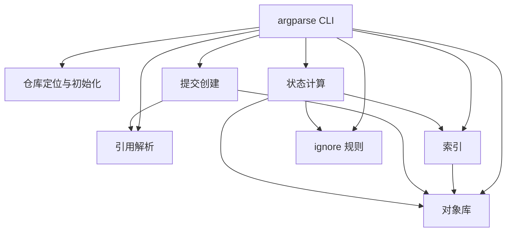

# 代码架构

miniGit 当前主要实现集中在 [`src/libminigit.py`](../src/libminigit.py)。文件按 Git 内部机制逐段组织，而不是拆成多个 Python 包。

架构图描述模块关系；算法的正确性、数据格式和复杂度请继续阅读[算法原理](algorithms.md)、[数据格式详解](data-formats.md)和[复杂度与性能模型](complexity.md)。




## 命令入口

文件开头创建 `argparse` 子命令，并在 `main` 中根据 `args.command` 分派到 `cmd_*` 函数。

当前命令包括：

```text
add, cat-file, check-ignore, checkout, commit, hash-object,
init, log, ls-files, ls-tree, rev-parse, rm, show-ref, status, tag
```

## 仓库层

`GitRepository` 表示工作区和 `.minigit`，主要函数包括：

- `repo_create`：创建目录结构和默认配置
- `repo_find`：从当前目录向父目录查找仓库
- `repo_path`、`repo_file`、`repo_dir`：构造仓库内路径

## 对象层

对象层使用继承表达四种对象：

- `GitObject`
- `GitBlob`
- `GitTree`
- `GitCommit`
- `GitTag`

`object_read` 负责识别对象类型；`object_write` 负责序列化、哈希、压缩和落盘。

## Tree 层

`GitTreeLeaf` 表示一个 Tree 条目；`tree_parse` 和 `tree_serialize` 处理 Tree 的二进制格式。

`tree_from_index` 负责把索引中的文件路径重新组织为嵌套 Tree，并返回根 Tree SHA-1。

## 引用层

- `ref_resolve`：读取并递归跟随引用
- `ref_list`：递归列出 `refs/`
- `ref_create`：写入引用文件
- `object_resolve`：解析 HEAD、哈希、标签和分支
- `object_find`：解析名称并按类型跟随对象

## 索引层

`GitIndexEntry` 描述单个索引条目，`GitIndex` 描述索引整体。

- `index_read`：读取 DirCache v2 基本格式
- `index_write`：写回索引
- `add`：写 Blob 并追加索引条目
- `rm`：删除索引条目并删除工作区文件

## 状态和 ignore 层

`cmd_status` 将比较拆成两段：

1. HEAD Tree 与索引
2. 索引与工作区

`GitIgnore` 保存绝对规则和按目录作用的 scoped 规则；`gitignore_read` 从配置文件和索引中的 `.gitignore` 构造规则集合。

## 提交层

`cmd_commit` 的主要流程是：

1. 读取索引。
2. 调用 `tree_from_index` 创建目录树。
3. 调用 `commit_create` 创建 Commit。
4. 更新活动分支引用。

## 源码阅读建议

推荐按照以下顺序阅读：

```text
repo_create / repo_find
  ↓
object_read / object_write
  ↓
GitBlob / GitTree / GitCommit
  ↓
index_read / index_write
  ↓
add / tree_from_index
  ↓
commit_create / ref_resolve
  ↓
status / check-ignore
```
