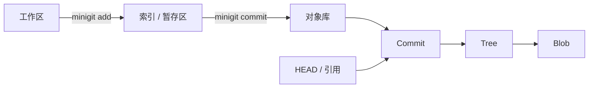

# 核心概念

miniGit 的实现围绕四个区域展开：工作区、索引、对象库和引用。



## 工作区

工作区是用户实际编辑的文件目录。miniGit 会扫描工作区，用文件的元数据和内容判断文件是否被修改、删除或尚未跟踪。

## 索引

索引位于 `.minigit/index`，也叫暂存区。它记录下一次提交要包含的路径、文件元数据和 Blob SHA-1。

工作区的修改不会自动成为提交内容，必须先通过 `minigit add` 更新索引。

## 对象库

对象库位于 `.minigit/objects/`。文件内容、目录结构、提交信息和附注标签都会被编码为对象，并按 SHA-1 存储。

对象是不可变的：内容相同就得到相同 SHA-1，内容变化就产生新的对象。

## 引用

引用是指向对象的可读名称，例如：

```text
HEAD                  -> refs/heads/master
refs/heads/master     -> commit SHA-1
refs/tags/v1          -> commit 或 tag SHA-1
```

引用文件本身很小，但它们让用户不必记住完整的对象哈希。

## 提交

Commit 对象保存一次版本快照的入口和历史关系：

- `tree`：这次提交的根目录树
- `parent`：父提交，可重复出现
- `author`：作者和时间
- `committer`：创建提交的身份和时间
- 提交消息

提交只保存目录树的 SHA-1，不直接复制所有文件内容。

## 从文件到提交

一次普通提交可以抽象为：

```text
文件内容
  ↓ hash-object
Blob
  ↓ add 写入索引
索引条目
  ↓ tree_from_index
Tree（可能包含子 Tree）
  ↓ commit_create
Commit
  ↓ 更新活动引用
refs/heads/master
```

## SHA-1 内容寻址

miniGit 对对象计算的哈希输入不是裸文件内容，而是：

```text
<类型> <内容长度>\0<内容>
```

例如 Blob 的形式是：

```text
blob 6\0hello\n
```

随后结果会使用 zlib 压缩并保存到 `.minigit/objects/` 下的两级路径中。
