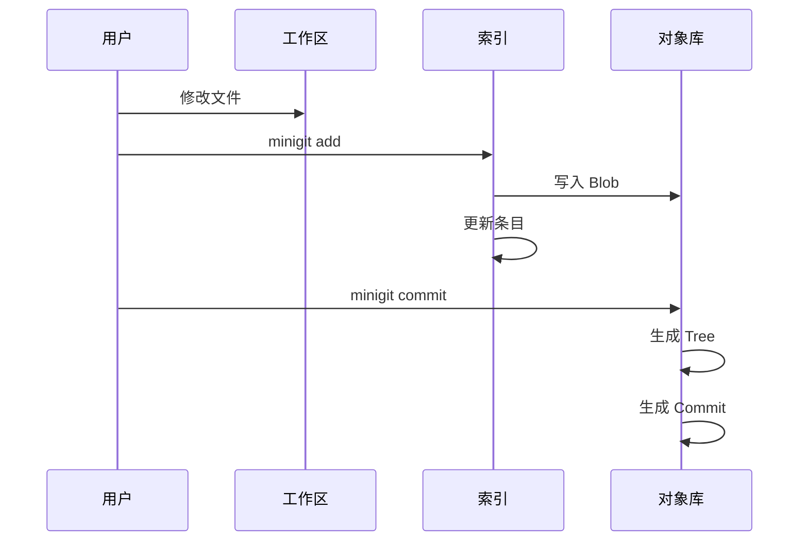

# 索引与暂存区

索引是工作区和提交之间的中间层。它让用户可以先选择要提交的内容，再生成提交。

索引的二进制布局、对齐规则和状态比较算法分别见[数据格式详解](data-formats.md)与[算法原理](algorithms.md)。



## 索引条目

每个 `GitIndexEntry` 记录：

- 创建时间和修改时间
- 设备号和 inode
- 文件类型和权限
- 用户 ID、组 ID 和文件大小
- Blob SHA-1
- stage 和 assume-valid 标志
- 使用 `/` 分隔的仓库相对路径

## `add` 的内部流程

`add` 的实现分为几步：

1. 从索引中移除同名旧条目。
2. 将输入路径转换为工作区内的绝对路径和仓库相对路径。
3. 读取文件并写入 Blob 对象。
4. 读取文件元数据。
5. 创建新的索引条目。
6. 将完整索引重新写回 `.minigit/index`。

```bash
minigit add hello.txt
minigit add src/main.py
```

当前 `add` 接受文件路径；目录递归添加不属于当前实现范围。

## `ls-files`

列出索引中的路径：

```bash
minigit ls-files
minigit ls-files --verbose
```

`--verbose` 还会显示索引版本、条目类型、权限、Blob SHA-1、时间、设备、inode 和标志。

## `rm`

`rm` 同时从工作区删除文件并从索引移除条目：

```bash
minigit rm hello.txt
```

如果路径不在索引中，命令会失败；实现内部提供了跳过缺失路径的参数供 `add` 重用。

## 从索引生成 Tree

`tree_from_index` 会把索引路径按目录分组，从最深目录向根目录构建 Tree：

```text
src/main.py
src/lib/util.py
        ↓
src Tree
        ↓
root Tree
```

每个目录都会变成一个 Tree 对象，根 Tree 的 SHA-1 会写入 Commit 的 `tree` 字段。

## 当前格式边界

miniGit 能够读取真实 Git 写入的常见索引，也能让真实 Git 读取它生成的索引用于一般命令。但当前索引写入仍缺少标准 20 字节 trailer，完整 `git fsck` 可能报告索引损坏，详见[互操作性](compatibility.md)。
