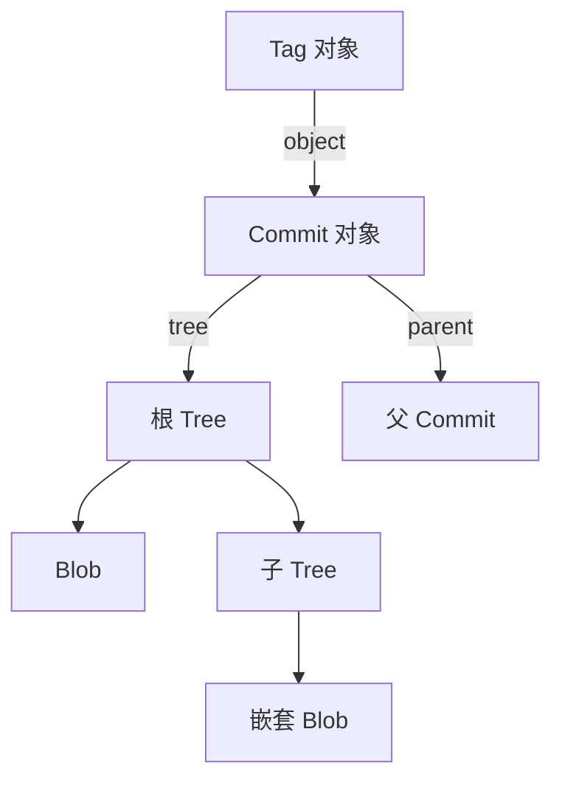
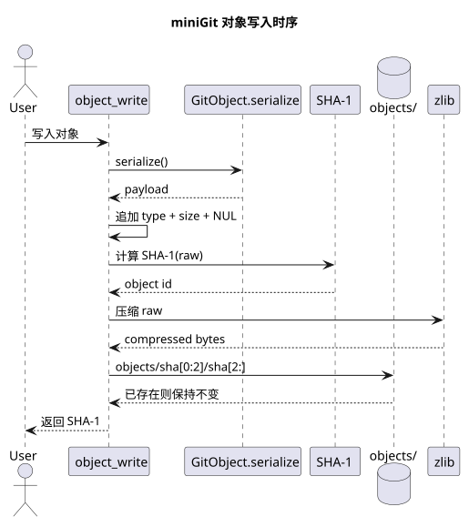

# 对象数据库

对象数据库是 miniGit 保存版本内容的核心。对象由类型、长度和内容组成，再使用 SHA-1 标识。

对象写入的形式化过程、复杂度和正确性不变量见[算法原理](algorithms.md)；具体字节布局见[数据格式详解](data-formats.md)。






## 通用对象格式

```text
<type> <size>\0<serialized content>
```

`object_write` 会完成以下步骤：

1. 调用对象的 `serialize`。
2. 添加类型和内容长度头部。
3. 计算完整数据的 SHA-1。
4. 在需要时使用 zlib 压缩并写入对象库。

`object_read` 则执行反向过程，并根据类型选择 `GitBlob`、`GitTree`、`GitCommit` 或 `GitTag`。

## Blob

Blob 保存文件的原始字节，不保存文件名。文件名由索引或 Tree 保存。

```bash
minigit hash-object hello.txt
minigit hash-object -w hello.txt
minigit cat-file blob <blob-sha>
```

相同字节会得到相同 Blob SHA-1，因此两个文件可以共享同一个 Blob。

## Tree

Tree 表示目录。每个 Tree 条目包含：

- 模式，例如普通文件 `100644`
- 名称
- 指向 Blob 或子 Tree 的 SHA-1

Tree 使用二进制条目序列化，条目按名称排序；目录名称在排序时追加 `/`，以匹配 Git 的树排序规则。

```bash
minigit ls-tree HEAD
minigit ls-tree -r HEAD
```

## Commit

Commit 使用键值行格式保存提交元数据：

```text
tree <tree-sha>
parent <parent-sha>
author Test User <test@example.com> <timestamp> <timezone>
committer Test User <test@example.com> <timestamp> <timezone>

提交消息
```

初始提交没有 `parent` 行；后续提交通过 `parent` 连接到前一次提交。

## Tag

轻量标签只是一个引用文件；附注标签是一个真正的 Tag 对象：

```text
object <commit-sha>
type commit
tag v1
tagger Minigit <minigit@example.com>

消息
```

## 对象命令

| 命令 | 作用 |
|---|---|
| `hash-object` | 计算对象 SHA-1，可选择写入对象库 |
| `cat-file` | 读取指定类型对象的序列化内容 |
| `ls-tree` | 展示 Tree 对象的条目 |
| `checkout` | 根据 Commit 或 Tree 重建文件目录 |

## 代码入口

- `GitObject`：对象基类
- `GitBlob`：Blob 对象
- `GitTree`：Tree 对象
- `GitCommit`：Commit 对象
- `GitTag`：Tag 对象
- `object_read`：读取并解码对象
- `object_write`：序列化、哈希、压缩和写入对象
- `object_find`：将名称解析为指定类型的对象
