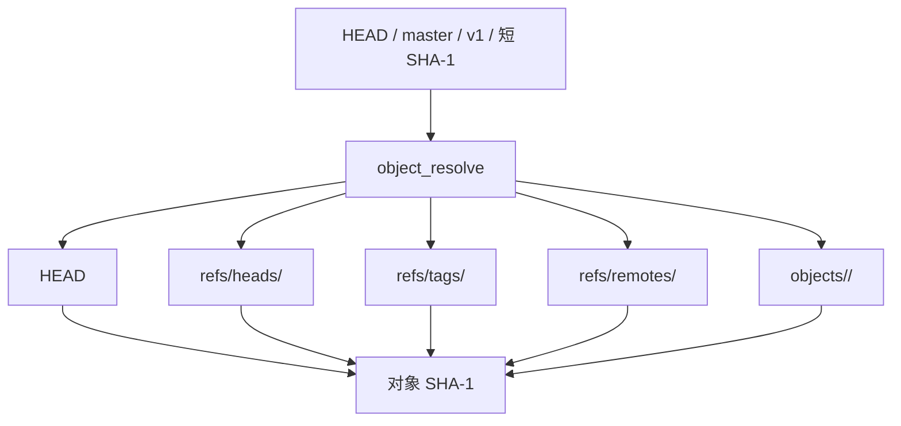

# 引用与修订表达式

引用是给对象 SHA-1 起的稳定名称。miniGit 当前支持 HEAD、分支、标签和短对象哈希的解析。





## HEAD

默认的 `HEAD` 内容是：

```text
ref: refs/heads/master
```

`ref_resolve` 会递归跟随 `ref:`，最终得到引用指向的 SHA-1。

## 分支

当前默认分支是 `master`。提交时，如果 HEAD 指向一个活动分支，miniGit 会更新：

```text
.minigit/refs/heads/master
```

当前命令集没有独立的 `branch` 命令，分支引用可以通过文件和 `show-ref` 观察。

## 标签

创建轻量标签：

```bash
minigit tag v1
```

创建附注标签：

```bash
minigit tag -a v2
```

列出标签：

```bash
minigit tag
```

## `show-ref`

```bash
minigit show-ref
```

它递归列出 `refs/` 下的引用，输出格式为：

```text
<sha> refs/heads/master
<sha> refs/tags/v1
```

## `rev-parse`

```bash
minigit rev-parse HEAD
minigit rev-parse master
minigit rev-parse v1
minigit rev-parse --minigit-type tree HEAD
```

名称解析顺序包括：

1. `HEAD`
2. 完整或短对象哈希
3. 标签
4. 本地分支
5. 远程分支

解析时可以要求对象类型。Commit 在要求 Tree 时会跟随其 `tree` 字段；Tag 在要求其他类型时会跟随其 `object` 字段。

## 当前修订表达式范围

miniGit 当前实现支持 `HEAD`、完整或短对象哈希、标签名、分支名和远程分支名，并支持在要求对象类型时跟随 Tag 到目标对象、跟随 Commit 到其 Tree。它不是完整的 Git revision parser；`HEAD~1`、复杂范围表达式、路径选择器和提交范围运算不属于当前实现。
