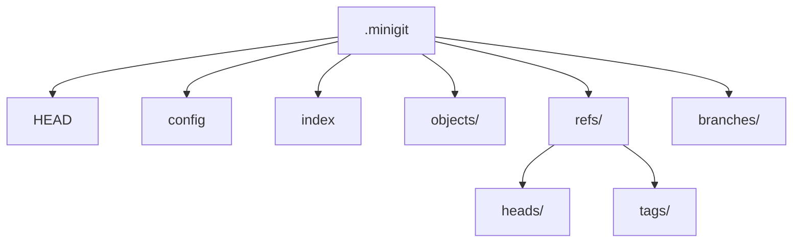

# `.minigit` 仓库目录结构

初始化仓库后，miniGit 会创建以下结构：

```text
.minigit/
├── HEAD
├── config
├── description
├── branches/
├── objects/
└── refs/
    ├── heads/
    └── tags/
```



## `HEAD`

新仓库默认包含：

```text
ref: refs/heads/master
```

它表示当前活动分支。`ref_resolve` 会继续读取 `refs/heads/master`，直到得到一个对象 SHA-1。

首次初始化后，分支引用文件可能还不存在，因为仓库尚未有提交。

## `config`

当前配置保存仓库格式信息：

```ini
[core]
repositoryformatversion = 0
filemode = false
bare = false
```

miniGit 只接受 `repositoryformatversion = 0`。

## `objects/`

对象路径使用 SHA-1 的前两个字符作为目录名，剩余字符作为文件名：

```text
.minigit/objects/ce/013625030ba8dba906f756967f9e9ca394464a
```

对象文件是 zlib 压缩数据。

## `index`

索引在第一次 `add` 前可能不存在。miniGit 使用 Git DirCache v2 的基本布局读取和写入索引。

索引包含：

- `DIRC` 魔数
- 版本号
- 条目数量
- 每个文件的时间、设备、权限、大小、Blob SHA-1 和路径

当前实现没有写入完整的标准索引 trailer，详见[已知限制](limitations.md)。

## `refs/heads/`

保存本地分支引用，例如：

```text
.minigit/refs/heads/master
```

文件内容通常是一个提交 SHA-1。

## `refs/tags/`

保存标签引用。轻量标签直接指向目标对象；附注标签指向一个 Tag 对象，再由 Tag 对象的 `object` 字段指向提交。

## `branches/`

目录会在初始化时创建，但当前命令集主要使用 `refs/heads/` 管理分支。
