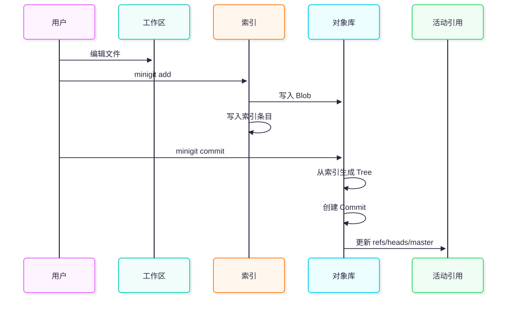

# 常见工作流

## 创建并提交文件

```bash
minigit init demo
cd demo
echo hello > hello.txt
minigit status
minigit add hello.txt
minigit status
minigit commit -m "add hello"
minigit status
```

流程如下：




## 修改后再次提交

```bash
echo "hello v2" > hello.txt
minigit status
minigit add hello.txt
minigit commit -m "update hello"
minigit log
```

第二个 Commit 会通过 `parent` 指向第一个 Commit。

## 查看提交内容

```bash
minigit rev-parse HEAD
minigit cat-file commit HEAD
minigit ls-tree HEAD
minigit ls-tree -r HEAD
```

## 导出一个版本

```bash
mkdir out
minigit checkout HEAD out
```

`checkout` 不会改变当前工作区，它把提交对应的 Tree 写入另一个空目录。

## 创建标签

```bash
minigit tag v1
minigit tag -a v1-annotated
minigit show-ref
```

## 删除文件并提交删除

```bash
minigit rm hello.txt
minigit status
minigit commit -m "remove hello"
```

此时新的根 Tree 不再包含 `hello.txt`。

## 使用忽略规则

```bash
echo "*.tmp" > .gitignore
minigit add .gitignore
echo scratch > scratch.tmp
minigit check-ignore scratch.tmp
minigit status
```

当前实现要求 `.gitignore` 先进入索引，规则才会被 `check-ignore` 和 `status` 使用。

## 与真实 Git 交叉检查

miniGit 生成的仓库可以交给真实 Git 读取：

```bash
git --git-dir=.minigit ls-files
git --git-dir=.minigit log --oneline
git --git-dir=.minigit cat-file -p HEAD
```

真实 Git 创建的 `.git` 目录也可以改名为 `.minigit`，再用 miniGit 读取其中的对象和索引，适合做互操作实验。
