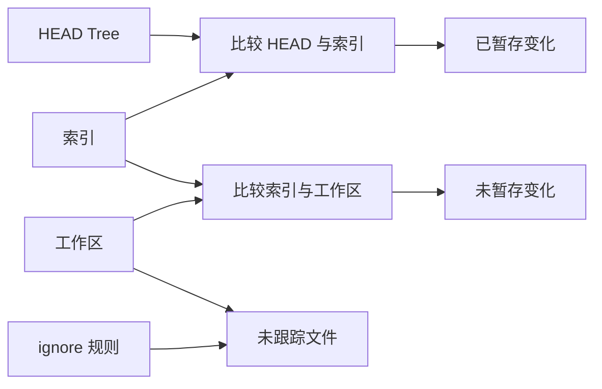

# 工作区状态与忽略规则

`status` 比较三个状态来源：HEAD 中的 Tree、索引和磁盘上的工作区。




## 已暂存变化

HEAD 与索引的比较产生：

- `added`：索引有，HEAD 没有
- `modified`：两者都有，但 Blob SHA-1 不同
- `deleted`：HEAD 有，索引没有

## 未暂存变化

索引与工作区的比较产生：

- `modified`：工作区内容的 Blob SHA-1 与索引不同
- `deleted`：索引有对应条目，但文件已不存在

实现先比较文件时间和大小等元数据；发现元数据变化后再计算 Blob SHA-1，因此只触碰 mtime 但不改变内容不会被报告为修改。

## 未跟踪文件

工作区中存在、索引中不存在、且没有被 ignore 规则匹配的文件会显示为未跟踪文件。

`.minigit` 目录本身不会被当作工作区文件扫描。

## `.gitignore`

当前实现会读取：

- `.minigit/info/exclude`
- 用户级 `git/ignore`
- 已经进入索引的 `.gitignore` 文件

规则支持：

- `#` 注释
- `!pattern` 否定规则
- `\pattern` 转义首字符
- 通配符匹配
- 根目录和子目录范围规则

```bash
minigit add .gitignore
minigit check-ignore build/output.o
```

注意：当前实现的 `.gitignore` 读取语义与完整 Git 不完全相同。尤其是工作区中的 `.gitignore` 必须先进入索引后才会参与规则计算。

## `status` 的输出区域

```text
On branch master.
Changes to be committed:
...

Changes not staged for commit:
...

Untracked files:
...
```

首次提交前运行 `status` 仍有教程实现遗留的边界限制，详见[已知限制](limitations.md)。
